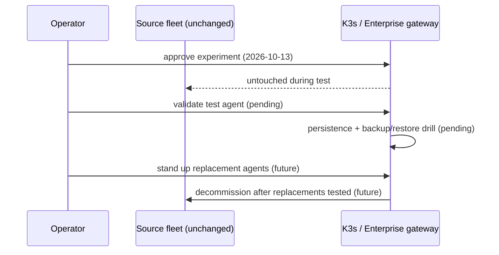

## The idea

Explore whether a small Kubernetes deployment can give OpenClaw a **repeatable home**, with explicit
recovery and isolation tests before any existing work moves. **Enterprise is a project nickname**, not
a claim of vendor support, a separate product, high availability, or production readiness.

The source fleet remains in place; it has not been migrated or replaced. Its routing and roster can evolve independently of this experiment.

## Three words that are not interchangeable

| Label | Meaning here | Claimed? |
|---|---|---|
| **Ready** | The gateway pod reports Ready, its health checks answer, and its state survives a pod restart. | **Yes - this far, and no further.** |
| **Production-ready** | Backup/restore drilled for this project, isolation exercised both ways, a test agent completing real work. | No - none of that is demonstrated yet. |
| **Migrated** | Existing agents actually moved onto the new platform. | No - nothing has moved. |

## Fresh verification — 2026-10-14

The gateway and three Kubernetes core-service pods are Running/Ready, the persistent volume is
Bound, and the loopback health endpoint responds. The previous pod-recreation persistence test
remains a dated proof, not a new restore test.

Three delivery gaps are now explicit: **private overlay access still needs sign-in**, the weekly
backup job protects the superseded container rather than the replacement VM, and the replacement
VM has **automatic boot disabled**. No backup archive or snapshot for it was found. Do not depend
on the experiment returning after a host reboot or recovering from data loss yet.

The next milestone is still a disposable agent completing real model, tool and memory work,
followed by traffic-boundary tests and an isolated restore. No replacement agent has been accepted.

## How the lab got here

The lab ran for months as a single-source installation: one host, one operator, a small agent fleet
that earned its keep by verifying its own work. On 2026-10-06 the public handbook **froze** - a pause,
deliberately taken, not a decommission. On 2026-10-13 publication resumed, and with it this question:
could Kubernetes give the platform a repeatable home?

```mermaid
flowchart LR
  A["One hypervisor, one lab"] --> B["Small agent fleet (source install)"]
  B --> C["Pause: handbook frozen 2026-10-06"]
  C --> D["Revival + experiment: OpenClaw Enterprise on K3s"]
  D --> E["Attempt 1: container runtime — contained, disk kept"]
  E --> F["Attempt 2: virtual machine — K3s Ready"]
  F --> G["Gateway pod Ready, state persists, Flash route"]
  G --> H["Validate one test agent (next gate)"]
  H --> I["Replacement agents stand up on the new platform"]
  I --> J["Old fleet decommissioned in batches after testing"]
  J --> K["Operator-facing coordinator remains (main)"]
```

## What actually happened

- **The first attempt stayed inside a container** on the hypervisor. It hit container-runtime limits
  and was **contained**: the guest kept its disk, the unsafe host binds were removed, and nothing on
  the source fleet changed. A contained failure, recorded as one.
- **The experiment moved to a virtual machine** on the same hypervisor - same size, cleaner
  boundaries. K3s came up, and the gateway runs the **official OpenClaw release image, pinned by
  digest**, not a custom build.
- **The gateway pod is Ready.** Health checks answer, state persists across pod restarts, and the
  configured model route is the inexpensive Flash model - the expensive one is not in use.
- **Still not production.** No migration, no replacement agents yet, and no backup-restore drill
  published for this project. One physical hypervisor also remains a single failure domain, however
  many pods run on it.

| Milestone | State |
|---|---|
| Experiment approved and contained within its own guest | Done |
| K3s cluster up on a virtual machine | Done |
| Gateway pod Ready, health checks passing, state persisting | **Done - 2026-10-13** |
| One test agent completing a bounded, harmless task | Next gate - not yet |
| Backup and isolated restore drill for this project | Not demonstrated |
| Allowed and denied traffic exercised both ways | Not demonstrated |
| Replacement agents stood up and tested | Not started |
| Source fleet decommissioned in batches | Not started |

Hermetic tests exercise the bootstrap code against controlled inputs. They do not prove that this
platform can start a pod, recover application data, or enforce a boundary - and existing backup
proofs for other lab services are not substitutes for this project's own drill.

## The plan, stated as a plan

If - and only if - the experiment proves out: stand up new agents on the platform, test each one,
then decommission the old fleet in batches. The operator-facing coordinator (**main**) remains while
replacements earn their place. Every step reversible; every step recorded.

## Keep the two systems separate

The [agent roster](/agents/) describes the existing fleet and its configured model routes.
The [service map](/service-map/) distinguishes measured boundaries from untested paths.
The [status page](/status/) and [known issues](/backlog/) carry this project's state alongside the
rest of the lab's open work. The experiment stays visible without pretending to be finished.
